# Design document: a knowledge graph of CRM data and sales calls

Showpad take-home, "Knowledge Graph Engineer - System Design & Prototyping Assignment". This document follows the
brief's structure: Part 1, the five Part 2 challenges, then Part 3. The slides (`slides/deck.md`) are the short version.

- **[built]** marks what the prototype in this repository implements; everything else is design.
- **Measured** figures come from this repository's runs. Other figures cite their published source.

## Where each part of the brief is answered
| Brief | This document | Slides | Code and evidence |
|---|---|---|---|
| Part 1: use case, combining CRM data with cross-customer transcript insights to unblock a stalled deal | §1 | 2-4 | `src/kg/queries.py` (`deal_brief`), `uv run kg brief` |
| Scope: assumptions and non-goals | §1.1 | 14 | |
| Ontology: buying committees, CRM entities, conversational concepts | §2.1 | 6 | `src/kg/schema.py`, `src/kg/graph.py` |
| Ingestion and scalability: batch CRM, asynchronous post-call, at scale, failure modes | §2.2 | 5, 7 | `src/kg/extract.py`, `runs/`, `docs/model-comparison.md` |
| Accuracy and entity resolution: accuracy, hallucinations, linking a casual name to a CRM contact | §2.3 | 8, 9 | `src/kg/validate.py`, `src/kg/resolve.py`, `src/kg/verify.py`, `src/kg/evaluate.py`, `docs/stress-test.md`, `docs/stress-test-full.md` |
| Querying and consumption: deterministic features and natural-language queries (GraphRAG) | §2.4 | 10 | `src/kg/queries.py`, `src/kg/ask.py`, `docs/ask-examples.md`, `scripts/ask_eval.py` |
| Technology selection, justified by Showpad's constraints | §2.5, §2.6, ADR-003 | 11, 12 | |
| Part 3: mock CRM and transcript, LLM extraction, lightweight graph | §3 | 13 | `data/`, `prompts/extract_v3.md`, `src/kg/` |
| Deliverables: trade-offs | §4 (ADRs), §5 (success metrics), §6 (risks) | 14 | |

## 1. Part 1: Product application and use case
> "Describe a scenario where combining CRM data with cross-customer transcript insights accelerates a deal or
> unblocks a stalled opportunity."

Tom sells Kestrel QMS (quality-management software). His €210k deal with Aurelia Foods has sat in "Proposal" for
58 days, and the close date has moved twice. The CRM shows a champion and a stage. The calls show the rest:
- **The person who signs was never on a call.** Above €200k the group CFO signs, and nobody has met him. Two other
  mentions ("Hendrik Ahlders", a transcription error, and "the CFO") are the same person.
- **A cheaper competitor is in play.** Veritrack is "about thirty percent below" Kestrel. Budget is explicitly not the
  problem: "Budget isn't the problem" must not be read as a budget objection.
- **Kestrel is behind on a promise.** The security pack promised for 16 October is overdue, and its CRM task says
  "Not Started".
- **Another of Kestrel's own customers already left Veritrack.** Brennan Packaging ran it for a year and pulled out
  after a nine-month implementation. Brennan's CRM record has no competitor entry; only the call knows.

The deal brief puts these together, each with its quote and call. Tom prepares a payback case for the CFO, sends the
overdue pack, and frames time-to-value against the lower price. He uses Brennan's experience for his own preparation
only and never quotes Brennan to Aurelia **[built: `uv run kg brief`]**.

"Cross-customer" here means across one Showpad customer's own accounts, inside its own CRM. Nothing crosses Showpad
customers. Inside the company, a seller sees other accounts only as far as the CRM lets them (§2.4).

**Why this needs a graph:**
- **absence:** who never joined a call;
- **identity:** five names, one person;
- **exact filters across accounts:** same company, customer-voiced, asserted, visible to this seller.

Text search finds mentions but cannot prove absence or identity.

**Where it would show up.** One query catalogue (§2.4) feeds several surfaces:
- **Meeting preparation:** the brief, before Tom's next Aurelia call.
- **Deal reviews:** stall signals and committee gaps, for Tom's manager.
- **The in-app assistant:** competitor precedents as a tool a seller can ask.
- **Phase 2, Showpad's own differentiator:** link each open objection to the content that answered it in won deals.
  It needs content-share events, which this prototype does not have.

### 1.1 Scope, assumptions and non-goals
**Assumptions** (each is reversible, and the numbers in §2.2 move with them):
- **Team.** About 3 engineers build v1.
- **Transcription.** Transcripts arrive transcribed and speaker-labelled. This is documented for Microsoft Teams and
  assumed for other recorders. Running speech-to-text on half the calls would add about $1.0-1.3M over 24
  months (35-minute calls at Deepgram and AssemblyAI list prices, October 2026).
- **Size.** 50,000 sellers, about 8 calls each a week, EU first, then US.
- **Linking calls to deals.** Calls usually arrive linked to their deal (through the calendar event or the recorder).
  When they don't, a scored time window picks the deal.

**Not in v1**, with what would justify each and the cost of waiting:

| Not built | What would justify it | Cost of waiting |
|---|---|---|
| Benchmarks across Showpad customers | Opted-in customers, a legal review, k-anonymous aggregates in a separate store | Low: the per-customer graph is the prerequisite anyway |
| Automatic CRM write-back (roles, new contacts) | Reviewers accepting suggestions at a high rate | Sellers apply suggestions by hand; "add to CRM" stays a review action |
| Scoring or ranking sellers from their calls | A separate product with HR and legal review; the EU AI Act lists worker evaluation as high-risk (Annex III) | None for this use case |
| Free text-to-Cypher for every tenant | Logged `kg ask` questions the catalogue cannot answer | Those questions get "I can't answer that" |
| Live, in-call assistance | A sub-second pipeline and a different product | None for pre-call preparation |
| Running speech-to-text | Customers whose recorders give no transcript | Their calls are not covered |
| Objection → content recommendations | Content-share events joined to calls | Showpad's differentiator arrives in phase 2 |

## 2. Part 2: Technical architecture and system design


**Constraints assumed for Showpad:**
- **Infrastructure:** AWS, with EU data in eu-central-1 (Frankfurt) and US data in us-west-2. Managed AWS services
  (OpenSearch, S3, Lambda, CDK) add no new vendor.
- **Product:** isolation between tenants, sub-second reads on product pages, and SLAs for white-labelled products.
- **Compliance:** ISO 27001, ISO 27701 and SOC 2 Type II. No training on customer data. Each new vendor adds
  procurement time.
- **Existing AI:** the in-app assistant's results are scoped to the user's permissions and CRM session. LLM access goes
  through a gateway. Microsoft Teams transcripts already arrive transcribed.

These are assumptions. Where Showpad's real setup differs, the design says what would change.

### 2.1 Ontology definition
> "How would you design the initial schema to model the complex relationships between buying committees, CRM
> entities, and conversational concepts (e.g., pain points, competitor mentions) extracted from transcripts?"



**Derived from the use case's questions** (who signs, why is it stuck, who faced this competitor), not from a generic
sales model. Four layers, 12 node types and 16 edge types **[built]**:
- **CRM:**
  - Nodes: `Account`, `Contact`, `User`, `Opportunity`, `Task`, `Competitor`.
  - Edges: `WORKS_AT`, `FOR_ACCOUNT`, `OWNED_BY`, `ON_DEAL_TEAM`, `ON_COMMITTEE_OF` (from CRM contact roles),
    `COMPETES_WITH`, `HAS_TASK`.
- **Transcript:**
  - `Call` `ABOUT` `Opportunity`, and `Call` `HAS_TURN` `Turn`.
  - A contact is `INVITED_TO` a call (from the calendar event).
  - `Turn` `SPOKEN_BY` a speaker mention.
- **Mention:** a `Mention` is a speaker, or a span naming a person, `EVIDENCED_BY` its turn. It is linked by
  `REFERS_TO` (decided) or `CANDIDATE` (scored, for review) to a contact, a user, or a provisional `Person` not yet in
  the CRM.
- **Claim:** an `Assertion` node for each of five conversational concepts: pain point, competitor stance, objection,
  commitment and **buying-committee role** (economic buyer, champion, technical evaluator, procurement, influencer and
  so on).
  - Each claim is `EVIDENCED_BY` its turn, with the exact quote and character span.
  - It has a `SUBJECT` (who) and an `OBJECT` (a `Competitor`, or a `Concept` such as a pain theme).

A test checks that the code uses exactly these types and that this section names every one (`NODE_TYPES` and
`EDGE_TYPES` in `src/kg/graph.py`).

**The buying committee comes from both sources.** CRM contact roles give `ON_COMMITTEE_OF`; the calls give
committee-role claims with evidence. The committee query compares the two. That is how "economic buyer: Henrik
Aalders, never on a call, no CRM role" is found.

**Decisions:**
- **A claim is a node, not an edge.** It carries quote, modality (`asserted` / `negated` / `hypothetical`), status
  (`committed` / `needs_review`), model and prompt version. That costs one hop per query. It buys audit, review, and
  deletion of everything derived from one call.
- **Closed vocabularies per tenant.** A competitor list and a seeded pain taxonomy; unknown values go to review instead
  of becoming new types. The stress test showed the cost of skipping this: 40% of claims went to review on an
  unconfigured tenant, against 12% on a configured one. Onboarding therefore seeds the lists from the CRM's competitor
  field and product catalogue (`docs/stress-test.md`).
- **Speaker side on every claim.** A seller's opinion of a competitor is kept, but never counted as customer evidence.
- **Property graph, one schema source.** RDF stores' tenancy primitives fail open, and claims are reified in either
  model. The schema is defined once: LinkML in production,
  Pydantic in the POC. The validator generated from it is the schema gate, because Neptune enforces only ID
  uniqueness.

**The same pain from two contacts is one concept and two claims.** Each claim keeps its own speaker and quote. The
shared `Concept` node is what lets queries count across calls and accounts.

**Ownership and evolution:**
- **One owner.** The knowledge-graph team owns the types. Tenants extend only the vocabularies (competitors, pain
  themes), never the types.
- **Additive changes.** New predicates or edges are added and versioned. A rename or removal goes through
  deprecation, never a breaking edit.
- **Versions on every run.** Each run records its prompt version and a schema version (a hash of the output contract)
  **[built]**, so a schema change is visible in the data.
- **Re-extraction is a budgeted replay** of stored transcripts.

The production schema adds an assertion lifecycle (`candidate → committed → superseded | retracted`) and scored
`ABOUT` links for calls whose deal is not given.

### 2.2 Ingestion and scalability
> "How would you architect the data pipeline to handle both batch updates (CRM data) and streaming/asynchronous
> processing (post-call transcripts) at scale?"

**CRM, batch plus change stream:**
- An initial snapshot (Salesforce Bulk API 2.0, HubSpot, Dynamics), then changes through Salesforce Change Data Capture
  and webhooks.
- CDC events are replayable for 72 hours but lossy at the edges (gap and overflow events, whose remedy is a full
  re-read), so a nightly reconcile is mandatory (Salesforce, Change Data Capture Developer Guide and Pub/Sub API
  documentation, Winter '27).
- Every connector emits one change envelope onto Kafka (MSK), keyed `tenant|crm|object|id`.

**Calls, asynchronous after the call:**
1. The recorder webhook stores the transcript in S3 under a content hash, and a thin event points at it.
2. One durable workflow per call runs extract → validate → resolve. Each step is retried and idempotent.
3. The workflow's output goes onto the same mutation topic as CRM changes.

**One writer.** A single idempotent graph writer upserts on deterministic IDs (`tenant|label|natural-key`) behind a
version guard. It appends every change to a fact log in S3. The graph is a projection of that log.

**Reprocessing.** A better prompt means re-running extraction on stored transcripts into a new run ID and swapping
facts; nothing is migrated. That is how the prototype went from prompt v1 to v3 **[built: `runs/`]**.

**At scale** (the size assumed in §1.1: 50,000 sellers, about 8 calls each a week, about 1.7 million calls a month):
- **Load.** About 0.7 calls per second on average. A durable workflow engine handles that easily; a stream processor
  is not needed.
- **The bottleneck is LLM quota, not the graph.** The workflow engine rate-limits per tenant, so one large customer's
  backlog cannot delay another's briefs. Backfills run in a separate, lower-priority lane.
- **Freshness target:** brief updated p50 ≤ 5 minutes and p95 ≤ 15 minutes after the call.
- **Product reads.** Product surfaces read precomputed read models, not the graph. That keeps reads under a second
  whatever the graph's load.

**LLM cost.** Measured on 500-word third-party calls (`docs/model-comparison.md`):

| | Per call | 1.7M calls a month | Per seller a month |
|---|---|---|---|
| Opus 5.5 on every call | $0.058 | about $100k | about $2.00 |
| Haiku 5.5, Opus 5.5 for the 9.2% with a shared first name **[built]** | about $0.008 | about $14k | about $0.28 |
| **The same, with prompt caching [built, measured on all 3,454 third-party calls]** | **$0.0055** | **about $9.5k** | **about $0.19** |

- **Prompt caching.** The 5,351-token prefix (the instructions plus the output schema) is the same on every call.
  It is written to the cache once, then read on later calls at 5% of the input price on Opus. Measured on the mock
  calls: an Opus call on a 500-word transcript falls from $0.058 to $0.038, and quality is unchanged (0 wrong links,
  18/18 required facts).
- **Measured at full size.** The last row is measured, not projected: 3,454 calls for $18.87, 0 failures, 70% of input
  tokens read from the cache (`docs/stress-test-full.md`).
- **Call length.** Real 35-minute calls are several times longer than these, and cost grows with length. A labelled
  sample of real calls fixes the budget before launch.
- **Not yet applied:** half-price batch for backfills. On Bedrock the newest models have no batch mode in the EU.

**Failure modes, and what breaks first.** At 10× the load, LLM throughput quotas and cost break first, then the review
queue (people), long before a graph database. In the prototype's in-memory store, the first thing to break at 3,454
calls was an unindexed query. Every precedent scanned all 107,000 nodes, and the report did not finish in ten
minutes. An index of claims by call fixed it: 19 s for the whole report, 10 ms for the slowest brief.

| What fails | How it is detected | What the system does |
|---|---|---|
| The LLM provider is slow, rate-limited or down | Queue depth and step latency per tenant | The workflow retries with backoff. Per-tenant quotas stop one backlog starving the others. Briefs show the last good state and its date |
| The model refuses, or the output is cut off or invalid | Stop reason; parse failure | A server-side fallback model where the API offers one. Otherwise the call goes to a dead-letter queue with its reason. No partial writes: one transaction per call |
| A tenant backfills 10,000 old calls | Backfill lane depth | A separate low-priority lane, at batch prices where allowed. Live calls keep their freshness target |
| CDC gap or overflow | Gap event; nightly reconcile diff | Re-read the affected objects. The version guard drops stale writes |
| A contact is added or renamed after extraction | CRM change event | Re-resolve that account's open mentions from the stored extractions, with no LLM call **[built: tested]** |
| A wrong link or a wrong claim is found | A reviewer, or a seller flagging a quote | Retract it (a status change) and re-project the read models. Every claim carries its run and prompt version, so a bad prompt's claims can be retracted together |
| A prompt or model change lowers quality | Answer-key and use-case checks in CI; a shadow run on a sample | The release is blocked; reprocessing waits until the checks pass |
| A deletion request for a call | The request | Remove the call and everything derived from it, then rebuild the affected read models **[built: `remove_call`, tested]** |
| A transcript contains injected instructions | A probe set in CI | Extraction has no tools and a fixed schema, and every claim must quote the call (§2.6) **[built: probe passes on Haiku and Opus]** |
| A query is slow at full size | A load test on a full tenant | Index the lookups the catalogue makes (claims by call) **[built: found and fixed at 3,454 calls]** |

### 2.3 Accuracy and entity resolution
> "Unstructured data extraction is notoriously noisy. How will you ensure high accuracy, handle hallucinations, and
> perform entity resolution (e.g., linking a casually mentioned name in a transcript to the correct CRM contact)?"

**Five layers against hallucination [built], plus a verifier [built, not yet gating]:**

| Layer | What it stops | Evidence |
|---|---|---|
| 1. Schema-constrained output | Free text, missing fields | Pydantic contract, structured outputs |
| 2. Verbatim quote, located in the cited turn | Invented facts | 0 of 141 quotes rejected with prompt v3; an invented quote is rejected (`tests/test_validate.py`) |
| 3. Modality | "Budget isn't the problem" read as a budget objection | 0 of 6 planted traps became facts, in all seven v3 runs |
| 4. Review status | Implied or out-of-vocabulary claims stated as fact | Implied claims, unknown competitors and themes go to review |
| 5. An answer key written before the prompt | Silent regressions | 18/18 required facts. Precision 83% against the key as written; 100% after a logged review of the extras |

**Misread meaning, and the verifier [built: `src/kg/verify.py`].** A real quote with a misread meaning passes layer 2.
Flip the negated budget objection to asserted, keep its real quote, and it reaches the brief; only the answer key's
trap check flags it. The verifier is a second model call that asks whether the quote, read with the turns around it,
supports the claim as stated:
- On that case it rejects "Budget isn't the problem" filed as a budget objection, and accepts the negated reading.
- On 300 random claims from the full stress test: 69% fully supported (95% interval 63-74%), 31% partly, 0
  unsupported. For committed claims, 79% fully supported, against 48% for those held for review.
- "Partly" means a category boundary or a thin role inference, not invention.
- In production it gates high-stakes claims (who signs, competitor stance) before the brief states them; it is not
  yet wired into the pipeline.

**Who signs needs two calls** (designed, not built). Economic-buyer and champion roles count as confirmed only when two
calls agree. From one call they are shown as "likely", with the quote.
Today the brief states Henrik as the economic buyer from one call.

**No confidence scores from the model.** A model's self-reported confidence is not calibrated, so the system never
thresholds or multiplies it. Status comes from checks: quote found, vocabulary known, support explicit or implied. Link
scores come from code.

**Measuring hallucination in production:**
- the share of quotes rejected per run;
- verifier disagreement on sampled claims;
- reviewer rejections per predicate;
- the must-not traps, re-run in CI on every prompt or model change.

**Entity resolution: the model describes, code matches [built]:**
- **The model describes** each person as the call does: their side, and the role the conversation gives them ("group
  CFO", "procurement"). It never picks a CRM record.
- **Code matches** in two steps (blocking). First it matches against the people the call is plausibly about: the
  account's contacts, everyone on the call, and the deal's owner and team. Only if nobody there fits does it widen to
  all sellers, and widening never breaks a tie. It uses email, then name with nicknames and spelling similarity, then
  title. Surnames are compared by edit distance, so "Lucas Almeida" and "Lucas Moreira" no longer tie.
- **A speaker's side comes from the recorder,** so it filters the pool before names are compared. A mentioned person's
  side is only the model's guess, so it never decides a tie on its own.
- **Link only when clearly ahead:** score ≥ 0.85 and a margin ≥ 0.15. Otherwise the mention stays "not sure", with
  scored candidates for review, or becomes a provisional person.
- **Unknown people are merged per call.** "The group CFO", "Hendrik Ahlders" and "the CFO" become one person with all
  aliases, offered as "add to CRM".
- **At full size** (3,454 calls, 93 sellers): all 6,909 speakers link correctly against the dataset's own IDs, and 95%
  of person mentions link, with 4% "not sure". Before blocking, 26% were "not sure", because "Thanks, Liam" tied with
  sellers never on the call (`docs/stress-test-full.md`).
- **Shared names need a second clue.** When a name fits several people (two Pieters, one per side), one hint cannot
  decide.

**Worked example.** "Hendrik Ahlders will ask about payback": no exact name match, but Jaro-Winkler similarity to
Henrik Aalders, the customer side and a "group CFO" role hint all point to the CRM contact Henrik Aalders (Group CFO).
The link is stored with its score and method, so it can be audited and undone.

**What the measurements added** (`docs/model-comparison.md`):
- Cheaper settings beat the same-name rule with one misreading. The model's side guess and role hint are not
  independent clues.
- So the cascade sends calls with a shared first name to Opus at high effort, decided in code before extraction
  **[built]**.
- A sturdier rule needs a clue the model does not produce, such as who was speaking.

**Two further entity-resolution problems:**
- **CRM-to-CRM duplicates.** These need a probabilistic matcher (Splink) writing reversible `SAME_AS` edges.
- **Matching a call to its deal** when the recorder does not say. This uses a scored time window.

**Evaluation in production:**
- a labelled sample per tenant segment;
- per-predicate precision, with a lower bound required before a predicate may skip review;
- review-queue rate and reviewer agreement;
- the use-case checks run as regression tests on every prompt or model change.

The prototype already does this on a small scale: 79 tests, an answer key with logged adjudication, and a third-party
stress test that found six breaks, all fixed.

### 2.4 Querying and consumption
> "How should the application layer interact with the graph? Describe how you would expose this data to power both
> deterministic application features and natural language queries (e.g., GraphRAG)."

**Applications never query the graph directly.** A query service owns a versioned catalogue of parameterised queries.
It binds the tenant from the caller's identity, and the seller's visibility from CRM sharing.

**Deterministic features [built: `src/kg/queries.py`]:**
- the buying committee and its gaps;
- why a deal is stalled;
- competitor precedents in the company's other accounts.

They combine into the deal brief. In production their results are precomputed into read models for the deal page,
alerts and meeting prep.

**Ranking at scale [built].** On the full stress test a deal had 188 competitor precedents at the median, up to 626.
The brief keeps one per account, ranked by shared pains, then the most telling stance, then recency. It shows three per
competitor plus "N more"; `kg ask` gets the best ten and the total. Briefs fell from 137 lines at worst to 31.

**Latency budgets:**
- **Deal page:** reads a precomputed read model, target p95 ≤ 100 ms.
- **Catalogue queries against the graph:** a fixed shape of at most three hops, target p95 < 1 s.
- **Read models** are rebuilt when a claim's status changes, so a correction does not leave a stale card.

A catalogue query in Neptune's openCypher (illustrative; the POC runs the same logic in Python, and no query has been
run on Neptune yet):

```cypher
// competitor_precedents. The query service writes the tenant prefix (t42_) from the authenticated tenant and
// fills $visibleAccountIds from CRM sharing; neither comes from the caller or a model.
MATCH (o:t42_Opportunity {id: $opportunityId})-[:FOR_ACCOUNT]->(own:t42_Account)
MATCH (o)-[:COMPETES_WITH]->(comp:t42_Competitor)
MATCH (a:t42_Assertion {predicate: 'competitor_stance', modality: 'asserted', speaker_side: 'customer',
                        status: 'committed'})-[:OBJECT]->(comp)
MATCH (a)-[ev:EVIDENCED_BY]->(t:t42_Turn)<-[:HAS_TURN]-(c:t42_Call)-[:ABOUT]->(:t42_Opportunity)
      -[:FOR_ACCOUNT]->(acc:t42_Account)
WHERE acc <> own AND acc.id IN $visibleAccountIds
RETURN comp.name AS competitor, acc.name AS account, a.value AS stance, ev.quote AS quote, c.id AS call, t.id AS turn
```

**Natural language: the model calls the catalogue as tools [built: `kg ask`, `docs/ask-examples.md`].**
- The model chooses tools and phrases the answer. It never writes a query and never chooses whose permissions apply.
- Every statement cites its call and turn.
- The recorded answers show:
  - a seller without access getting a count instead of a name;
  - a deal the seller cannot see not being revealed;
  - "I can't answer that" for data the graph does not hold.
- In production the same tools are exposed over MCP to Showpad's assistant.
- **Smoke evaluation [built: `scripts/ask_eval.py`, prompt `ask_v2`]:** 13 questions with deterministic checks (tools
  called, facts present, restricted details absent, refusals). One runs on a graph with a planted claim whose quote
  tells the assistant to change its answer. Results:
  - 13 of 13 pass;
  - the planted instruction was ignored, and its claim flagged for checking;
  - 31 of 32 quoted phrases occur verbatim in a transcript. The other was shortened with an ellipsis.

  Passage search, once it exists, adds Recall@k and MRR (§5).

**What "GraphRAG" means here.** The model retrieves through typed graph tools and answers with claims tied to transcript
spans. Two parts of the usual GraphRAG toolkit are left out:
- **Free text-to-Cypher.** It runs only for tenants on their own cluster, where the database enforces the boundary
  (§2.6).
- **Community summaries.** Broad questions ("top objections this quarter") are aggregations over claims, each returning
  its evidence. Microsoft-style global GraphRAG answered "not enough information" questions correctly 19.27% of the
  time, against 96.01% for plain RAG (Han et al., "RAG vs. GraphRAG: A Systematic Evaluation and Key
  Insights", arXiv 2502.11371 v3, 2026).

**Vectors** have one job: finding the passage for a question no claim covers. Transcript passages are indexed in
OpenSearch kNN and searched as one more tool. Every vector carries its tenant, source node and model version.
Results are re-read through the graph, so a deleted call or a merged contact never resurfaces from the index.

**When not to use the graph.** "What did they say about onboarding?" has no claim type behind it, so it goes to
passage search, which is cheaper and recalls better. The graph is for questions that need absence, identity or exact
counts.

**Permissions.** Every query runs as a seller. Facts from accounts the seller cannot open appear as counts, never names
or quotes **[built: `kg brief --as`, `kg ask --as`]**.
- **Minimum group size.** In production a count appears only above a minimum group size (for example 5), so a count of
  one cannot point at a single account. The POC shows the raw count.
- **Visibility.** The POC approximates it from deal ownership and deal teams; production syncs the CRM's sharing
  rules.

### 2.5 Technology selection
> "What specific tools, databases, and frameworks would you select for the extraction engine, orchestration pipeline,
> and graph storage? Justify your choices based on our specific constraints and goals."

| Component | Choice | Showpad constraint it answers | Rejected alternative | Would change if |
|---|---|---|---|---|
| **Graph storage** | **Amazon Neptune Database** (openCypher), provisioned, Multi-AZ, eu-central-1 first | Managed on AWS in the EU region; no new vendor to approve | Neo4j Aura on AWS: a database per tenant, but a new vendor and about 65% more over 24 months. RDF stores: tenancy fails open | ADR-003 |
| Passage search | **OpenSearch** kNN | Managed on AWS. Neptune documents a vector index only for Neptune Analytics, not for Neptune Database | Vectors in the graph: not available on Neptune Database as documented | |
| **Extraction engine** | **Claude** through Showpad's LLM gateway, structured outputs. **Haiku 5.5, with Opus 5.5 for calls with a known hard case.** EU calls through Bedrock in the EU | Cost per seller at scale; EU residency; no training on customer data | Sonnet as the default: missed real objections and linked the wrong Pieter. Opus on every call: about 7× the cost for the same quality on the mock calls | A cheaper model passes the answer key and the stress set |
| **Orchestration** | **Temporal** (a durable workflow per call), Temporal Cloud or self-hosted on EKS; Kafka (MSK) as the change log | Runs on EKS or as a managed service; retries, idempotency and replay for reprocessing | Airflow or Dagster: batch-shaped work units, and one partition per call exceeds Dagster's guidance within a day. Stream processors: built for far higher event rates | The team prefers serverless only: Step Functions with Lambda |
| CRM ingestion | Bulk API, CDC and a nightly reconcile into one change envelope | Fresh CRM data without full re-reads | CDC alone: lossy at the edges | |
| Entity resolution | Rules and scores in code; Splink for CRM duplicates | Explainable decisions, tunable without re-prompting | A model picking CRM records: cannot be audited | Name variety outgrows rules: add phonetic matching and calendar signals |
| Read models | Precomputed per deal, in DynamoDB | Sub-second reads on product pages | Serving product pages from the graph | |
| Schema | LinkML, generating the Pydantic validator | Neptune enforces only ID uniqueness | Engine constraints | |
| Infrastructure | CDK, one stack per region | Infrastructure as code on AWS | | |
| Prototype | Python, Pydantic, NetworkX, Anthropic SDK | The brief asks for a lightweight graph | Neo4j in Docker: not needed for one tenant and two calls | |

### 2.6 Privacy, tenancy and security
- **Data boundary.** All data belongs to one Showpad customer. Inside it, CRM visibility applies, and other accounts'
  insights are for internal preparation only. Cross-tenant benchmarks would be a separate, opt-in product.
- **Tenant isolation on Neptune.** Neptune "only supports a single graph per cluster", and its access control works per
  cluster (AWS Neptune User Guide, "Neptune compatibility with Neo4j"). So isolation follows AWS's own guidance:
  - **Contractual or largest tenants:** a cluster each, reached through a per-tenant role.
  - **Everyone else:** one shared cluster with tenant-prefixed labels and a tenant ID on every node. The query service
    writes the prefix into every catalogue query.
  - **The known risk** of the shared tier is a query that forgets the prefix. It is contained in three ways:
    - the model never writes queries;
    - every catalogue query is written and reviewed by engineers;
    - a CI test fails any catalogue query that does not bind the tenant.

  The POC tests the same property in code: a decoy tenant's claim about the same competitor never reaches Kestrel's
  sellers **[built: tested]**.
- **Residency.** EU tenants' data, models and backups stay in eu-central-1. Every claim knows its call, so deleting a
  call deletes what was derived from it **[built: `remove_call`, tested]**.
- **Transcripts are untrusted input.** A participant, a pasted note or a shared slide can contain instructions aimed
  at the model. Three things contain them:
  - extraction has no tools, and its output is a fixed schema;
  - every claim must quote the call, and the code checks the quote;
  - the tenant comes from the job, never from model output.

  The probe in `scripts/injection_probe.py` reads two injected instructions inside customer speech. One asks the model
  to record a signed contract and a rejected competitor; the other asks it to return nothing. Results on Haiku and
  Opus:
  - no injected statement became an asserted fact. Opus recorded the "rejected" line as negated, because the speaker
    adds that none of it is true;
  - the real objection and the real commitment were kept.

  The same holds when quotes reach the question-answering model. `kg ask` gets quotes and summaries as tool results,
  and prompt `ask_v2` says they are content, never instructions. In the smoke evaluation, a planted quote asking it to
  change its answer was ignored and reported as a suspect claim.
- **Queries and logs.** Graph queries are parameterised. The one value written into a label, the tenant prefix, is
  checked against a fixed pattern first. Transcript text is escaped in logs.

## 3. Part 3: AI-assisted proof of concept
> "Provide the system with a mock CRM JSON snippet and a mock snippet of a call transcript. Use an LLM API to extract
> entities and relationships based on your proposed ontology, and load them into a lightweight graph structure."

| The brief asks for | In this repository |
|---|---|
| Mock CRM JSON | `data/crm/kestrel_crm.json`: a Salesforce-style export (accounts, contacts, users, opportunities with history, contact roles, competitors, events, tasks, deal team) |
| Mock call transcript | `data/calls/`: two calls (49 and 21 turns) with planted traps (nickname, misspelling, title-only reference, two Pieters, negation, hypothetical, an unknown person). `data/probes/`: a prompt-injection probe |
| LLM extraction based on the ontology | `prompts/extract_v3.md` and `src/kg/schema.py`, with Claude structured outputs; raw outputs saved under `runs/` |
| Load into a lightweight graph | `src/kg/graph.py`: NetworkX, with the four layers of §2.1. `uv run kg build` writes `out/graph.html` |
| Rapid prototyping | Measured iterations: prompt v1 → v2 (a wrong link diagnosed and fixed), then break-it experiments (unknown people merged), then prompt v3 (third-party stress test), then a model comparison (cascade) |
| Effective extraction prompts | `prompts/`: no phrase shared with the test calls (a test enforces it); every version scored against the answer key |
| Raw AI output → structured graph | Validation gate, entity resolution and claim nodes; deterministic queries and `kg ask` on top |
| Evidence that the design's claims hold | Tests for deletion by call, a decoy tenant, idempotent reload, re-linking after a CRM change, and code-document ontology consistency; a prompt-injection probe; a `kg ask` smoke evaluation; a model comparison; a third-party stress test on 23 calls and then on all 3,454, with a verifier sample |

**Results on the main run** (`extract_v3__claude-opus-5-5`):
- 18/18 required facts;
- 11/11 people linked or correctly left unresolved, with 0 wrong links;
- 0 of 6 traps became facts;
- 21/21 use-case checks pass;
- precision 83% against the key as written before the prompt, and 100% after a logged review of the six extras (all
  defensible; rejected extras from other runs are logged in the key).

Run it: `uv run pytest` (79 tests, no API key), `uv run kg demo`.

## 4. Decisions and trade-offs (ADRs)
**ADR-001: Claims are reified as `Assertion` nodes.**
- **Decision:** quote, span, modality, status and provenance on every claim.
- **Cost:** one extra hop per query. In production, committed claims are also projected as plain edges
  (`ON_COMMITTEE_OF`, `COMPETES_WITH`) for fast reads.
- **Benefit:** audit, review and deletion by call.

**ADR-002: The model proposes, code decides.**
- **Decision:** the model never writes to the graph, never chooses a CRM record and never writes a query. Validation,
  entity resolution and the query catalogue are code with stored scores.
- **Consequences:** everything below the model is testable without the API (79 tests), and thresholds can be tuned
  without re-prompting. Some recall goes to "not sure".

**ADR-003: Amazon Neptune, with Neo4j Aura as the documented alternative.**
- **Context.** The graph store must:
  - run in eu-central-1;
  - isolate tenants;
  - serve the query catalogue;
  - suit a team of about three.
- **Options considered:**
  - Neptune Database;
  - Neo4j Aura Business Critical on AWS;
  - a self-managed graph (Apache AGE or FalkorDB) on EKS;
  - Postgres with pgvector and edge tables;
  - an RDF triple store.

  The last two are rejected before scoring:
  - **Postgres** is graph-poor: no graph algorithms, and Aurora offers no Cypher extension.
  - **RDF stores'** tenancy fails open or silently.
- **Gates, outside the matrix:**
  - runs in eu-central-1 under an AWS data-processing agreement;
  - enforces a tenant boundary for whichever query path ships;
  - has an acceptable licence (FalkorDB's SSPL needs legal review).
- **Weighted matrix** (scores 1-5; the scores are judgement, not measurement; costs are 24-month estimates at
  list prices):

| Criterion (weight) | Neptune | Aura | Self-managed |
|---|---|---|---|
| EU residency and procurement (14%) | 5 | 4 | 4 |
| Query capability for GraphRAG and text-to-Cypher (14%) | 3 | 5 | 3 |
| Operations for a team of about three (14%) | 4 | 4 | 2 |
| 24-month cost at 2,000 tenants (14%) | 5 ($1.71M) | 1 ($2.81M) | 4 ($1.75M) |
| Exit and portability (7%) | 4 | 3 | 3 |
| Licence risk (7%) | 5 | 5 | 2 |
| Isolation when a model writes queries (15%) | 2 | 4 | 4 |
| Fit with a catalogue that uses Neo4j-only features (15%) | 2 | 5 | 2 |
| **Score with all eight criteria** | 3.61 | **3.87** | 3.07 |
| **Score for v1 as designed: catalogue-only, portable queries** (last two rows weigh 0) | **4.3** | 3.6 | 3.1 |

- **Sensitivity.** Let w be the combined weight of the last two rows. Neptune scores 4.3(1−w) + 2w and Aura
  3.6(1−w) + 4.5w, so Neptune wins while w < 0.22.
- **Why the last two rows weigh nothing in v1.** The prototype shows that the use case is answered with catalogue
  tools only (`kg ask`): the model never writes a query. And its three catalogue queries need no Neo4j-only features.
  Aura's lead rests on exactly those two rows.
- **Decision:** Neptune.
  - **Good,** because it is managed on AWS, needs no new vendor, and costs about $1.1M less over 24 months at
    2,000 tenants.
  - **Bad,** because shared-tier isolation is application code, not a database boundary. Free text-to-Cypher is
    limited to tenants with their own cluster. And it has no vector index or in-engine graph algorithms.
  - **Neutral,** because about 80% of the system (pipeline, validation, entity resolution, query service) is the same
    on either store.
- **Consequences:**
  - OpenSearch for passages from day one.
  - The generated validator is the only schema gate.
  - A CI check binds the tenant in every catalogue query.
  - Similar-deal analytics run nightly on Neptune Analytics (pairwise similarity and community detection, no node
    embeddings).
- **Switch to Aura if:**
  - free-form questions become a product requirement for most tenants (w rises past 0.22);
  - a two-week bake-off shows the catalogue does not run in Neptune's openCypher;
  - per-tenant cluster quotas or operations become a problem.
- **Keeping the switch cheap:** catalogue queries stay in the portable openCypher subset, and the fact log can rebuild
  either store.

**ADR-004: A Haiku-to-Opus cascade, with the trigger in code.**
- **Measured:** Haiku matches Opus on typical calls. Cheaper settings fail on shared names.
- **Decision:** Haiku extracts every call. Calls with a shared first name in the deal's candidate pool go to Opus.
  The trigger is checked before extraction and logged with the run.
- **Consequences:** about 7× cheaper per typical call. A failure without a trigger stays at Haiku quality.
- **Next triggers:**
  - an unresolved mention with a plausible CRM match;
  - an open deal above a value threshold;
  - verifier disagreement.

**ADR-005: Precision over recall in entity resolution.**
- **Context:** a wrong link puts a quote in the wrong person's mouth in every query.
- **Decision:** link only above a high score with a clear margin; require a second clue for shared names.
- **Consequences:** a review queue, and many provisional people. Ebsta and Pavilion's 2025 GTM Benchmarks Report finds
  that 44% of the contacts sellers deal with are not in the CRM. Provisional people are merged per call and offered as "add to CRM".

**ADR-006: Typed tools before text-to-Cypher; no community summaries** (§2.4).

**ADR-007: One organisation's data, CRM visibility inside it** (§2.6).

**ADR-008: An answer key written before the prompt, adjudicated in the open.**
- **Decision:** the pre-registered key is the strict score. Extra claims from all saved runs were reviewed once:
  correct ones were added as optional facts, each with its reason, and rejected ones were logged.
- **Consequences:**
  - Both scores are reported.
  - A test guarantees the additions cannot improve the strict score.
  - The adjudication was done by Claude on David's delegation, and the key records that.

## 5. Success metrics
How we would know it works, from leading to lagging indicators:
- **For sellers** (a pilot randomised by seller):
  - the share of stalled deals where the economic buyer is engaged within two weeks of the brief;
  - days in stage after a brief;
  - overdue commitments closed.

  Win rate only as a holdout readout after two or more quarters.
- **Usage:**
  - briefs opened before a meeting;
  - quotes clicked;
  - "add to CRM" suggestions accepted.
- **Extraction quality:**
  - per-predicate precision on a labelled sample, with a lower bound before a predicate may skip review;
  - the review-queue rate;
  - the must-not traps.
- **Answers and retrieval:**
  - Recall@k and MRR for passage search;
  - citation validity;
  - correct refusals.
  - Zero leaks against a decoy tenant is a release gate.
- **Cost:** LLM cost per seller per month. It is about $0.19 with the cascade and caching on 500-word calls (measured:
  $0.0055 per call over 3,454 calls); real call
  lengths will set it.

## 6. Risks, open questions, and what the prototype does not prove
- **Accuracy on real calls is unproven.** The mock calls test judgment on known hard cases. The 23 third-party calls
  are LLM-generated and unlabelled. A labelled sample of real calls is the first production task, and it also fixes the
  LLM budget.
- **Misread meaning.** The verifier is built and measured on a sample, but does not yet gate claims. The two-call rule
  for who signs is designed, not built.
- **Review load.** 12% of claims on a configured tenant, 40% on an unconfigured one. Onboarding and approval tooling
  matter as much as the model.
- **Freshness against cost.** Batch pricing halves backfill cost but not post-call latency. On Bedrock, the newest
  models have no batch mode in the EU (Bedrock's Claude 5.5 model cards mark batch unsupported).
- **The store decision rests on catalogue-only questions.** If the product wants free-form questions for most tenants,
  ADR-003 switches to Aura. That is a product question to settle early.
- **Open questions for Showpad:**
  - real call lengths and volume per tenant;
  - whether a labelled sample of real calls exists;
  - the minimum group size for hidden-account counts;
  - which surface ships first (meeting preparation or deal reviews);
  - whether Showpad already runs a graph store, or has a preference.
- **Not built here:**
  - the streaming pipeline and the durable workflow;
  - Neptune and multi-tenancy;
  - the verifier as a gate, and two-call corroboration;
  - latency at scale.
