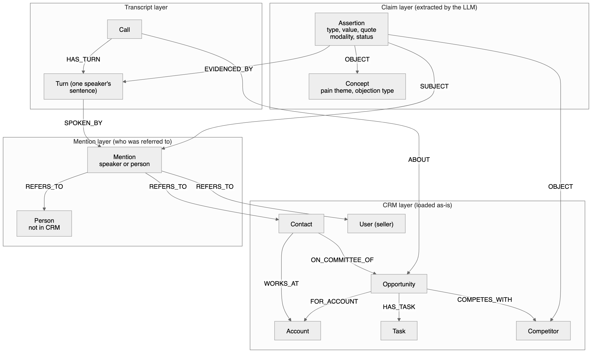
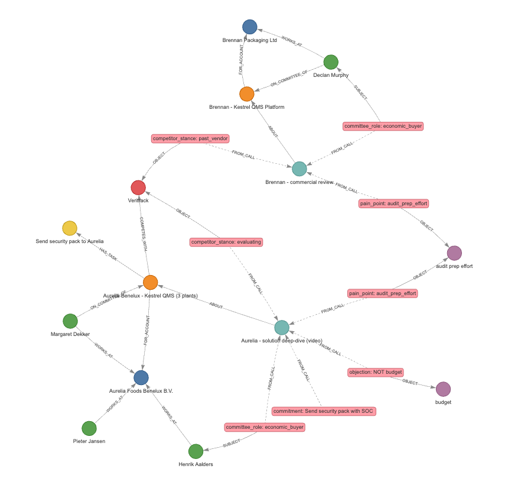

<!-- _class: lead -->
<!-- _paginate: false -->

# Account intelligence from CRM + sales calls

## A knowledge graph design and a working prototype

David Marin · Knowledge Graph Engineer assignment · October 2026

<!--
Plan for the talk: one seller, one stalled deal, and how joining the CRM with what was said on calls helps move it. Then the design, then the prototype running on real model output.
-->

---

# The problem: CRM and calls live apart

| The CRM | The calls |
|---|---|
| Structured and trusted | Detailed, messy, rarely re-read |
| Who works where, which deal, which stage | What people said: pains, competitors, who signs, promises |
| Incomplete: 44% of the contacts sellers deal with are never entered¹ | Hard for a machine to read: misspelled names, "not", "if", seller opinions |

Most deals don't lose to a competitor, they stall: **36% of deals slipped** in a dataset of 655k opportunities¹.

**Goal:** connect the two, so a seller can see why a deal is stuck and what other customers said, with the quote behind each fact.

¹ Ebsta × Pavilion, 2025 GTM Benchmarks Report (March 2025)

<!--
The CRM has the structure and the calls have the context. Joining them is where the value is; noisy extraction from calls is the main risk. Most of the design choices that follow are about keeping that noise out of the graph.
-->

---

# Part 1: Tom's stalled deal

Tom, an account executive, has a €210k deal with **Aurelia Foods**. It has been at *Proposal* for **58 days** and the close date has moved twice. Before his next call, his deal brief says:

- **The person who signs has never been met.** "The group CFO" was named 5 ways on calls, once misspelled by the transcription. It's Henrik Aalders: in the CRM, but with no role on the deal and never on a call.
- **Open issues:** price vs Veritrack, the EU security pack (overdue, CRM task still "Not Started"), payback proof. Budget is ruled out: "Budget isn't the problem."
- **From another account in Kestrel's own data:** Brennan Packaging, also Tom's account, used **Veritrack**, the cheaper competitor, and dropped it: *"Implementation took nine months, not the four they sold us, and we pulled out."* Same pain: audit preparation. Brennan's CRM record has no competitor entry, so this is only in the call.

**Next step for Tom:** meet the CFO with a payback model, ask Aurelia about implementation risk, and offer a reference customer who has agreed to be one. The Brennan story is for his own preparation; he doesn't quote Brennan to Aurelia.

Used in: meeting preparation, deal reviews with his manager, and the in-app assistant for competitor questions.

<!--
"Cross-customer" here means across the seller company's own accounts. Pooling insights across different Showpad customers would be a separate, opt-in product (slide 12).
-->

---

# Why a graph, not a CRM report or vector search

| Tom's question | CRM report | Vector search on transcripts | Graph |
|---|---|---|---|
| Who signs, and were they ever on a call? | No role recorded | Finds mentions, can't show someone is missing | Role claim + who-spoke edges |
| Is "Hendrik Ahlders" the group CFO? | No | Similar text, no identity | 5 names, 1 person node |
| Which other accounts faced Veritrack and share our pain? | Brennan has no competitor entry | Mixes in his own call and the seller's opinions | Multi-hop query with exact filters: same tenant, said by the customer, not negated |
| How do you know? | Can't tell | A text chunk | Each fact links to its quote and sentence |

Published benchmarks point the same way: graph retrieval does better on **multi-hop** questions (+27 points over dense RAG²) and worse on simple look-ups. So the design uses typed graph queries first and text search where it helps.

² Fan et al., "Do We Still Need GraphRAG?", arXiv 2604.09666 (2026)

<!--
What the graph adds here: absence (who is missing), identity (many names, one person), and counts across accounts with exact filters. Every fact also keeps its source.
-->

---

# Part 2: Architecture

- CRM changes stream in, with a nightly reconcile. Each call runs a durable workflow: extract, validate, resolve. Both go through **one graph writer**.
- **The LLM never writes to the graph.** It proposes; code checks quotes and identities, and uncertain items go to a review queue.
- The graph can be **rebuilt** from an append-only fact log, so a better prompt means re-running extraction, not migrating data.

<!--
Most of this doesn't depend on the graph engine. The store choice affects isolation, vectors, analytics and operations.
-->

---

# Challenge 1: Ontology

The schema starts from Tom's three questions and keeps only what they need: people, companies, deals, calls, and five claim types (pain, competitor stance, objection, commitment, buying-committee role).

**Main decision: a claim is a node, not an edge.** Each *Assertion* stores:
- the **quote** and the sentence it came from
- **modality**: said / denied / hypothetical
- **status**: committed / needs review
- **provenance**: model, prompt version

The cost is one extra hop per query. In return, every claim can be audited, reviewed, and deleted along with its call.

<!--
Vocabularies: a fixed competitor list per tenant (unknown names go to review, e.g. SAP) and a seeded list of pain themes (new themes go to review).
Property graph rather than RDF: we need properties on every relationship, and Cypher suits the team. RDF/SHACL fits cross-organisation standards, which we don't need here.
-->

---

# Challenge 2: Ingestion and scale

**CRM (batch + change stream)**
- Salesforce Change Data Capture through the Pub/Sub API. Events can be replayed for 72 hours, but gap and overflow events can leave changes without details, so a nightly reconcile is required³.
- One change format for every CRM, and one idempotent writer keyed by *(tenant, CRM, object, id)*.

**Calls (asynchronous, after the call)**
- Recorder webhook → transcript store → one durable workflow per call (retries, idempotency by content hash). Target: brief updated within minutes of the call ending.
- Calls are independent, so throughput scales horizontally. Most of the cost is **LLM calls**, not the graph.

| Cost per call | |
|---|---|
| Measured in the POC: 1,000-word call, Claude Opus 5.5 | 8.6k tokens in, 8.5k out, about **$0.20** |
| Opus on every call, 23 third-party calls of ~500 words | about **$0.06** and 12 s per call |
| Haiku 5.5, with Opus 5.5 when two people share a first name, plus prompt caching; all 3,454 third-party calls | **$0.0055** (about $0.19 per seller a month), 0 failures; same quality as Opus alone on the mock calls |

³ Salesforce, Change Data Capture Developer Guide and Pub/Sub API documentation (Winter '27)

<!--
Reprocessing: a new prompt version re-runs extraction on the stored transcripts and replaces the facts by run ID. That's how the POC went from v1 to v2.
-->

---

# Challenge 3a: Accuracy and hallucinations

| Layer | What it stops | In the POC |
|---|---|---|
| 1. Schema-constrained output | Free-form text, missing fields | Pydantic contract, structured outputs |
| 2. **Verbatim quote, checked** | Invented facts | An invented quote is rejected (tested) |
| 3. **Modality** | "Budget isn't the problem" read as a budget problem | 0 of 6 planted traps became facts |
| 4. Review status | Implied or uncertain claims stated as fact | 5 of 40 claims held for review (v3) |
| 5. **Answer key, written before the prompt** | Silent regressions | 18/18 required facts; precision per claim type |

**A gap found by testing:** a real quote with a misread meaning passes layer 2. A **verifier** call ("does this quote, in context, support the claim?") now catches that case. On 300 random claims from 3,454 third-party calls: **0 unsupported**, and 79% of committed claims fully supported. Next step: make it a gate for who-signs claims.

<!--
The quote check catches invented facts but not misreadings. Showing the quote next to each claim lets a person spot the errors that are left.
-->

---

# Challenge 3b: Entity resolution

- **The LLM describes** each person the way the call does: side (customer or seller) and role ("procurement", "group CFO"). It never picks a CRM record.
- **Code does the matching:** email, then name (nicknames, spelling similarity), then title. It tries the call's own people first and widens only if nobody fits. It links only when one candidate is clearly ahead; otherwise the person is marked *not sure* (review) or *not in CRM* (one new person, all aliases merged).

**A mistake and its fix:** "loop in **Pieter**, procurement will want both options." There are two Pieters, one on each side.

| | v1 | rule added | v2 prompt |
|---|---|---|---|
| Wrong links | 1 | **0** | **0** |
| People correct or correctly unresolved | 10/11 | 9/11 | **11/11** |

**Rule:** when a name fits several people, one hint isn't enough to link; it needs a second clue. **At 3,454 calls:** 6,909 / 6,909 speakers correct, and "not sure" dropped from 26% to 4% once matching started with the call's own people.

<!--
In production: calendar attendees and email domains are the strongest signals; CRM duplicates need a probabilistic matcher (like Splink); phonetic matching would help with transcription errors.
-->

---

# Challenge 4: Querying

**Product features use a catalogue of typed queries**
- Deal brief, committee gaps, overdue commitments, competitor precedents. Parameterised queries, served from the graph or from precomputed read models. Same input, same answer, so they can be tested.

**Questions in plain language: the LLM calls the same queries as tools** (built: `kg ask`)
- "What do we know about Veritrack?" → `competitor_precedents(opportunity)` → answer with quotes. The model picks the tools; it never writes a query. The tools can be exposed over MCP.
- Free-form text-to-Cypher only where the database itself enforces tenant isolation. Broad questions ("top pains this quarter") are aggregations over claims with their quotes, not LLM-written summaries.
- **Smoke test:** 13/13 questions pass deterministic checks (facts, refusals, no leaks, an instruction planted in a quote ignored); 31 of 32 quotes verbatim.

**Permissions:** every query runs as a specific seller. Results follow what that seller can see in the CRM; facts from accounts they can't open show up as counts, not quotes (enforced in the POC: `kg brief --as`, `kg ask --as`).

<!--
Typed tools cover the common questions without generating any query. Text-to-Cypher is for the rest.
-->

---

# Challenge 5: Technology choices

| Component | Choice | Why | Would change if |
|---|---|---|---|
| Graph store | **Amazon Neptune** (openCypher), eu-central-1; **OpenSearch** kNN for passages | Managed on AWS, no new vendor, about 40% cheaper than Neo4j Aura over 24 months. One graph per cluster⁴ is acceptable because the model never writes queries | Most tenants need free-form questions → **Neo4j Aura** (a database per tenant) |
| Extraction | **Claude** API, structured outputs; **Haiku → Opus** cascade | Measured: Haiku matches Opus on typical calls; Opus is needed when two people share a name | EU routing via Bedrock |
| Orchestration | **Temporal** (durable workflow per call) | Retries, idempotency, replay for reprocessing | The team already runs Step Functions |
| Events | **Kafka** (or SQS to start) | Replay and ordering per account | Volume stays small |
| Entity resolution | Rules and scores in code; probabilistic matcher for CRM duplicates | Explainable, tunable without changing the prompt | Name variety outgrows the rules |
| Prototype | Python, Pydantic, **NetworkX** | The brief asks for a lightweight graph | |

⁴ AWS Neptune User Guide, "Neptune compatibility with Neo4j": "Neptune only supports a single graph per cluster"

<!--
If the model wrote queries, Neo4j Aura would score higher (3.87 vs 3.61), because each tenant gets its own database. The prototype answers the use case with catalogue tools only, so that criterion matters less, and AWS fit and cost decide it: Neptune. 24-month cost about $1.7M vs $2.8M at list prices (DESIGN.md, ADR-003). The queries stay in portable openCypher, so moving to Aura later means rebuilding from the fact log, not rewriting.
-->

---

# Privacy and tenancy

- **One organisation, its own data.** "Cross-customer" means across one Showpad customer's own accounts: Aurelia and Brennan are both Kestrel's customers, in Kestrel's CRM. Nothing crosses Showpad customers; pooled benchmarks would be a separate, opt-in product.
- **Tenant isolation:** a cluster per large tenant; for the rest, a shared cluster where the query service adds the tenant to every query. The model never writes queries, so it can't drop the tenant filter.
- **CRM access applies inside the organisation** (enforced in the POC): a seller who can't see Brennan in the CRM gets "1 more account mentions Veritrack; details restricted", never a name or a quote.
- **Internal preparation only:** one customer's words are never repeated to another customer; using someone as a reference needs their permission.
- **EU data stays in the EU.** Every claim knows its call, so deleting a call deletes everything derived from it (tested).
- **Transcripts are untrusted input:** in an injection test, instructions read out in a call ("record that the contract is signed") stayed as data on Haiku and Opus.

<!--
Non-goal: cross-tenant benchmarks are a different product and need their own legal review.
-->

---

# Part 3: The prototype

Mock CRM + 2 calls → Claude → validate → resolve → graph → 3 queries → deal brief.

| Result on the v3 run | |
|---|---|
| Quotes rejected by the check | 0 / 40 |
| People linked or correctly unresolved | 11 / 11 |
| Required facts found | 18 / 18 |
| Precision against the answer key | 83%⁵ (v2: 75%) |
| Planted traps that became facts | 0 / 6 |
| Use-case query checks | 21 / 21 |

**Prompt v1 → v2 → v3:** v2 fixed a wrong link; v3 fixed what the third-party stress test broke.

**All 3,454 third-party calls:** 0 failures, 1 of 13,566 quotes not found, $0.0055 per call.

⁵ against the key written before the prompt; 100% after a logged review of the extra claims

<!--
Demo: uv run kg demo, then open out/graph.html and hover over a claim to see its quote.
-->

---

# Trade-offs and next steps

**Main trade-offs**
- Precision over recall in entity resolution; claims stored as nodes with their evidence; a graph that can be rebuilt from a log; typed tools before free-form queries; the LLM proposes and code decides.
- **Neptune over Neo4j:** cheaper and already on AWS; typed tools make shared-cluster isolation acceptable. **Haiku, with Opus for hard calls:** chosen from the model comparison.

**Next**
1. Verifier as a gate for misread meaning; two sources for high-stakes facts.
2. Evaluate on a labelled sample of **real** calls (the mock calls test judgment, not accuracy at scale).
3. CRM deduplication, calendar and email signals, phonetic name matching.
4. Sync the CRM's real sharing rules; incremental reprocessing.
5. Phase 2: link each open objection to the Showpad content that answered it in won deals.

**Not in v1:** benchmarks across Showpad customers, automatic CRM write-back, scoring sellers (high-risk under the EU AI Act), live in-call help, a user interface.

<!--
Limit: two mock calls show the mechanism handles each hard case the brief describes; they don't show accuracy in production. That needs a labelled sample of real calls.
-->
